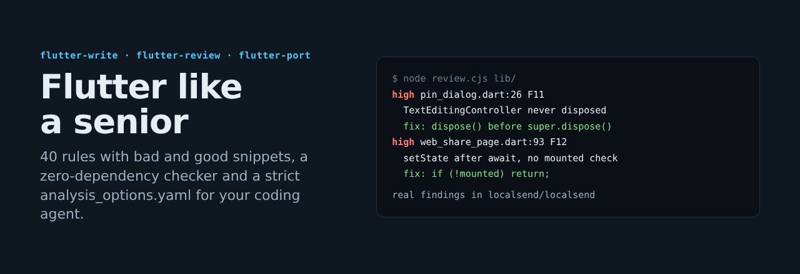

<p align="center">
  
</p>

<h1 align="center">flutter-senior-review</h1>

<p align="center">
  <b>Make your coding agent write Flutter like a senior, not like a tutorial.</b><br>
  Three agent skills (write, review, port), 40 rules with bad and good snippets, a zero-dependency checker and a strict <code>analysis_options.yaml</code>.
</p>

<p align="center">
  <a href="https://github.com/MBotirjonDev/flutter-senior-review/actions/workflows/test.yml"></a>
  
  
  <a href="LICENSE"></a>
</p>

---

## What changes

Code an agent writes by default compiles, runs in the demo and then leaks, crashes after a slow
request or rebuilds the whole screen on every keystroke. These are the pairs the skills fix.

**Leaked controllers (F11)**

```dart
// Before
class _SearchState extends State<Search> {
  final _query = TextEditingController();
  final _scroll = ScrollController();
  // no dispose()
}

// After
class _SearchState extends State<Search> {
  final _query = TextEditingController();
  final _scroll = ScrollController();

  @override
  void dispose() {
    _query.dispose();
    _scroll.dispose();
    super.dispose();
  }
}
```

**setState and context after await (F12, F13)**

```dart
// Before: throws if the user left the screen while saving
Future<void> _save() async {
  await repo.save(item);
  setState(() => _saved = true);
  Navigator.of(context).pop();
}

// After
Future<void> _save() async {
  await repo.save(item);
  if (!mounted) return;
  setState(() => _saved = true);
  Navigator.of(context).pop();
}
```

**Helper methods instead of widgets (F01)**

```dart
// Before: rebuilds with the parent, cannot be const
Widget _buildHeader() => Text(title, style: TextStyle(fontSize: 22, color: Color(0xFF222222)));

// After: its own element, theme-aware
class _Header extends StatelessWidget {
  const _Header({required this.title});
  final String title;

  @override
  Widget build(BuildContext context) => Text(title, style: Theme.of(context).textTheme.titleLarge);
}
```

**Flags instead of states (F19, F20)**

```dart
// Before
if (isLoading) return const CircularProgressIndicator();
if (error != null) return Text(error!);
return Text(user!.name);

// After: the compiler checks every case
return switch (state) {
  Loading() => const CircularProgressIndicator(),
  Failed(:final error) => ErrorView(error),
  Loaded(:final user) => Text(user.name),
};
```

## Install

```sh
git clone https://github.com/MBotirjonDev/flutter-senior-review
cp -r flutter-senior-review/skills/* ~/.claude/skills/
cp flutter-senior-review/analysis_options.yaml your_app/   # optional
```

Works with any agent that reads `SKILL.md`: Claude Code, Codex, Cursor, OpenCode and others.

| Skill | Use it when you say | What it does |
|---|---|---|
| `flutter-write` | "Build a settings screen" | Writes new code with the 40 rules, then runs the checker on it |
| `flutter-review` | "Review this file / PR" | Runs the checker, verifies findings by reading the code, reports severity, `file:line` and a fix |
| `flutter-port` | "Convert this React Native screen" | Maps state, effects, lists and styles to Flutter by meaning, not line by line |

## The checker

```sh
node skills/flutter-review/scripts/review.cjs lib/
```

```
high   lib/pages/web_share_page.dart:93  F12 setState after await without a mounted check
       fix: Add `if (!mounted) return;` after the await.
high   lib/widget/dialogs/pin_dialog.dart:26  F11 TextEditingController _textController is never disposed
       fix: Call _textController.dispose() in dispose(), before super.dispose().
```

Node 18+, no install. `--json` for machines, `--fail-on high|medium|low|none` for CI (default
`high`). It skips `build/`, `test/` and generated files.

## The 40 rules

Full text with why, bad and good: [rules/RULES.md](rules/RULES.md). ✓ = the checker finds it.

| Area | Rules |
|---|---|
| Widgets and build() | F01 widget classes, not helper methods ✓ · F02 const · F03 pure build() · F04 short build() ✓ · F05 keys in lists · F06 ListView.builder · F07 no Opacity/ClipRRect in hot paths · F08 SizedBox over Container · F09 MediaQuery.sizeOf ✓ · F10 LayoutBuilder for breakpoints |
| State and lifecycle | F11 dispose everything ✓ · F12 mounted before setState ✓ · F13 no context across async gaps ✓ · F14 lift state only as far as needed · F15 safe async in initState · F16 didUpdateWidget · F17 inherited widgets in didChangeDependencies · F18 nothing in createState |
| Null safety and types | F19 no `!` papering ✓ · F20 sealed classes + switch · F21 no default on sealed switches · F22 no dynamic · F23 final · F24 records |
| Async | F25 await or unawaited · F26 catch specific errors · F27 cancel and close streams · F28 Future.wait for independent calls |
| Theming and UI | F29 colors from the theme ✓ · F30 text from TextTheme · F31 text scaling · F32 48 dp targets · F33 Semantics and tooltips · F34 reduce motion |
| Navigation and structure | F35 routes, not flags · F36 IDs in routes · F37 feature folders · F38 no business logic in widgets · F39 no print ✓ · F40 one public widget per file |

Severity: **high** = crash, leak or wrong behavior; **medium** = jank, rebuilds, accessibility;
**low** = maintainability.

## Results on real apps

The checker on four well-known open-source apps. Every **high** finding below was checked by
hand against the source and is a real issue.

| App | High | Medium | Low | Examples of high findings |
|---|---:|---:|---:|---|
| [flutter/samples: compass_app](https://github.com/flutter/samples/tree/main/compass_app) | 0 | 0 | 1 | none |
| [localsend/localsend](https://github.com/localsend/localsend) | 4 | 4 | 22 | 3 undisposed `TextEditingController`s, `setState` after await in `web_share_page.dart` |
| [gskinnerTeam/flutter-wonderous-app](https://github.com/gskinnerTeam/flutter-wonderous-app) | 6 | 56 | 13 | undisposed `PageController`, `ScrollController`s and `FocusNode`, `setState` after await |
| [flutter/samples: material_3_demo](https://github.com/flutter/samples/tree/main/material_3_demo) | 10 | 5 | 7 | `setState` and `ScaffoldMessenger.of(context)` after `await showDatePicker` |

Most of wonderous's medium findings are F01 (47 helper methods returning widgets). Those are a
style trade-off, not bugs. While testing I fixed five kinds of false positives the first version
had: context used in the same statement as the await, `setState` from other state libraries,
`context.pop()` inside callbacks, controllers owned by the parent widget, and synchronous
`setState(() { if (...) })` blocks. Each one is now a test.

## analysis_options.yaml

49 lint rules on top of `flutter_lints`, plus `strict-casts`, `strict-inference`,
`strict-raw-types`, and the leak and async-gap lints promoted to errors. Each line says why.

Every rule and diagnostic name was checked with `dart analyze` (Dart 3.13.7), which reports
unknown and removed names. `require_trailing_commas` is left out because it fights the Dart 3.7+
formatter.

## Honest limits

- **The checker is regex-based, not the Dart analyzer.** It finds 9 of the 40 rules. The other 31
  need the agent (or you) to read the code. That is why `flutter-review` verifies findings before
  reporting them.
- **`analysis_options.yaml` was verified by name, not run on a Flutter project here** (no Flutter
  SDK in the build environment). Run `flutter analyze` on your app with it; the strict mode will
  likely report many issues on an existing codebase at first.
- **Rules are opinions of a senior reviewer, not laws.** Follow your project's conventions on
  style; the high-severity rules are the ones worth arguing for.

## Credits

The shape comes from [morganlinton/BeautifulRust](https://github.com/morganlinton/BeautifulRust).
See also the official [Flutter AI rules](https://docs.flutter.dev/ai/ai-rules); this repo adds a
checker, review output and porting guidance.

## More from me

- [flutter-unslop](https://github.com/MBotirjonDev/flutter-unslop): make your Flutter UI stop looking AI-generated
- [skillset-lint](https://github.com/MBotirjonDev/skillset-lint): lint Agent Skills one by one and as a set
- [uz_payments](https://github.com/MBotirjonDev/uz_payments): Payme and Click payments for Dart and Flutter

---

<p align="center">MIT · made by <a href="https://github.com/MBotirjonDev">Botirjon</a>, Flutter mentor in Uzbekistan</p>
